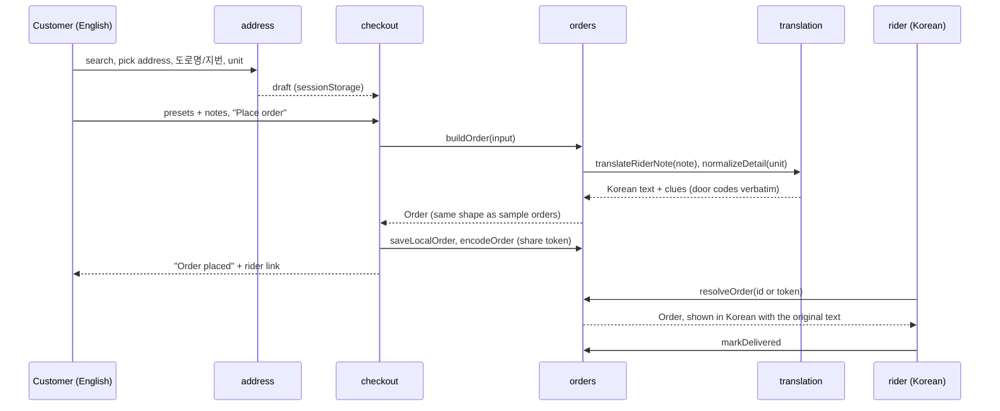

# Architecture

Audience: developers. Product behaviour is in [PRODUCT_OVERVIEW.md](PRODUCT_OVERVIEW.md); fields are in [DATA_MODEL.md](DATA_MODEL.md).

## 1. Shape of the codebase

A small, **feature-modular** React + TypeScript app. No backend: static files plus the browser. The same build runs as **mobile web** (the deliverable) and, optionally, inside an **Android shell** made with Capacitor (see section 7).

```
src/
├─ main.tsx                 entry: mounts <App/>, loads the CSS, calls initNative()
├─ app/                     the shell: route table + hash-route hook      (knows all features)
├─ domain/types.ts          data model, B3 field names                    (knows nothing)
├─ data/DataProvider.tsx    loads public/data/*.json, exposes useData()
├─ shared/                  code with no business rules
│  ├─ ui/                   TopBar, MapPlaceholder, Icons (SVG)
│  ├─ styles/               tokens.css (design tokens), global.css
│  ├─ routes.ts             every URL in one place (+ absoluteUrl for share links)
│  ├─ native.ts             Android-only setup (status bar, back button); no-op in the browser
│  └─ storage.ts            safe localStorage / sessionStorage
├─ features/                one folder per capability; each has index.ts + README.md
│  ├─ address/              search, pin on map, address details (screens 01, 02, Confirming Address)
│  ├─ checkout/             notes, place order, confirmation, order tracking (screen 03, Order Tracking)
│  ├─ orders/               build, store, share and find orders
│  ├─ translation/          note → what the rider needs (clues, rules, optional AI)
│  ├─ rider/                the Korean rider screens        (screen 04 + list)
│  └─ store/                the Korean shop order screen    (Order, Store View)
└─ test/                    fixtures + the architecture test
public/data/                B1 addresses, B2 orders (sample data, unchanged)
android/                    Capacitor Android project (generated; web build is copied in)
capacitor.config.ts         app id, name, web dir
docs/                       documentation and provided resources
```

## 2. Dependency rules (enforced by `src/test/architecture.test.ts`)

```
app ──► features ──► shared ──► domain
         │  ▲
         └──┘ only through each other's index.ts
```

1. `domain` imports nothing from the app.
2. `shared` may use `domain` only. It must not import `features`, `data`, or `app`.
3. `features` talk to each other **only through `@/features/<name>`** (the barrel `index.ts`). Never `@/features/orders/kst`.
4. A feature never reaches outside its folder with `../` and never imports `app`.
5. No import cycles between features. Today: `address` ← `orders` → `translation`; `checkout` → `address`, `orders`, `translation`; `rider` → `orders`, `translation`; `store` → `orders`.

The test fails the build when a rule is broken, so the structure cannot rot silently.

**Import style:** `@/…` aliases (configured in `tsconfig.json` and `vite.config.ts`) for anything outside the current folder; `./file` inside a feature.

## 3. How an order moves through the system



Key decisions:
- **Translate once, at placement.** The result is stored in the order, so the rider screen is instant and always shows the same text. Sample orders have no stored translation, so the rider screen computes it on the fly with the same function.
- **The order travels in the link** (base64url JSON, `orders/shareToken.ts`). That makes the rider screen work on a second device with no server. Trade-off: "delivered" is stored per device, not shared.
- **Hash routing** (`#/…`) works on any static host without rewrite rules.
- **Never lose the original.** The rider screen always shows the customer's text; a translation is an addition, not a replacement.

## 4. Where to change things

| I want to… | Edit |
|---|---|
| Add or change a Korean phrase | `features/translation/rules.ts` + a case in `translation.test.ts` |
| Recognise a new kind of clue (e.g. "elevator") | `features/translation/clues.ts`, show it in `features/rider/RiderScreen.tsx` |
| Turn on AI translation | set `VITE_AI_ENDPOINT` (see [DEVELOPMENT.md](DEVELOPMENT.md)); logic is in `translation/pipeline.ts` |
| Change the address search rule | `features/address/addresses.ts` + `addresses.test.ts` |
| Add a screen | create it in its feature, export it from that `index.ts`, add a builder to `shared/routes.ts` and a branch in `app/App.tsx` |
| Change native behaviour (status bar, back button) | `shared/native.ts` (only runs inside the Android app) |
| Build the Android APK | see section 7 and the README |
| Add a backend | replace `orders/shareToken.ts` and `orders/localOrders.ts` with API calls using the same function names |
| Change colours or spacing | `shared/styles/tokens.css` (values come from the design guide) |

## 5. Adding a new feature (checklist)

1. `src/features/<name>/` with the code, `index.ts` (public API only), `README.md`, and `<name>.test.ts`.
2. Depend on other features only via their `index.ts`.
3. Run `npm run typecheck && npm test`. The architecture test tells you if a rule broke.
4. Add the feature to the table in [PRODUCT_OVERVIEW.md](PRODUCT_OVERVIEW.md) and note the step in [PROGRESS.md](PROGRESS.md).

## 6. Known limits

- Translation covers common English phrases only; other languages show the original and a notice until AI is switched on.
- No shared state between devices (no backend), so the customer never sees "delivered".
- The map is an illustration; address search runs on the 30 sample addresses. "Pin on Maps" picks the nearest sample address.
- Order tracking progress follows the order status; the 12 min estimate and the Message button are demo placeholders.
- Android shell: the "open on another device" share link is web-only (hidden in the app).

## 7. Android shell (Capacitor)

The deliverable is **mobile web**. The Android app is an optional wrapper around the same build: no separate code, no native screens.

```
npm run build ─► dist/ ─► npx cap sync android ─► android/app/src/main/assets/public ─► gradlew assembleDebug ─► app-debug.apk
```

- **What is native:** only `android/` (generated by Capacitor) and `shared/native.ts`. `initNative()` returns at once in a browser (`Capacitor.isNativePlatform()`), so the web build behaves exactly as before.
- **`initNative()`** sets the status bar (white, not overlaying the page) and maps the hardware back button to history back (exit on the first screen).
- **Origin is `https://localhost`.** Hash routing, `fetch(BASE_URL + "data/...")` and `localStorage` all work unchanged. The one thing that does not carry over is a share link built from the origin; `absoluteUrl()` therefore returns `null` inside the app and the "open on another device" link is shown on the website only.
- **Safe areas:** screens and the fixed bottom button use `env(safe-area-inset-*)` (`--safe-top`, `--safe-bottom` in `global.css`). Do not put `overflow-x:hidden` on `html`/`body`: it stops touch scrolling in the Android WebView. `.screen` already clips sideways overflow.
- **Web changes need a sync.** After editing `src/`, run `npm run android:sync` before building the APK, or the app keeps the old bundle.
- **Needs:** JDK 21, the Android SDK, and `android/local.properties` (`sdk.dir=...`, git-ignored). Steps are in the README ("Run as an Android app").
- External links (Kakao navigation) open in the phone's browser; `tel:` opens the dialer. Fonts load from Google Fonts when online and fall back to the system Korean font offline.
